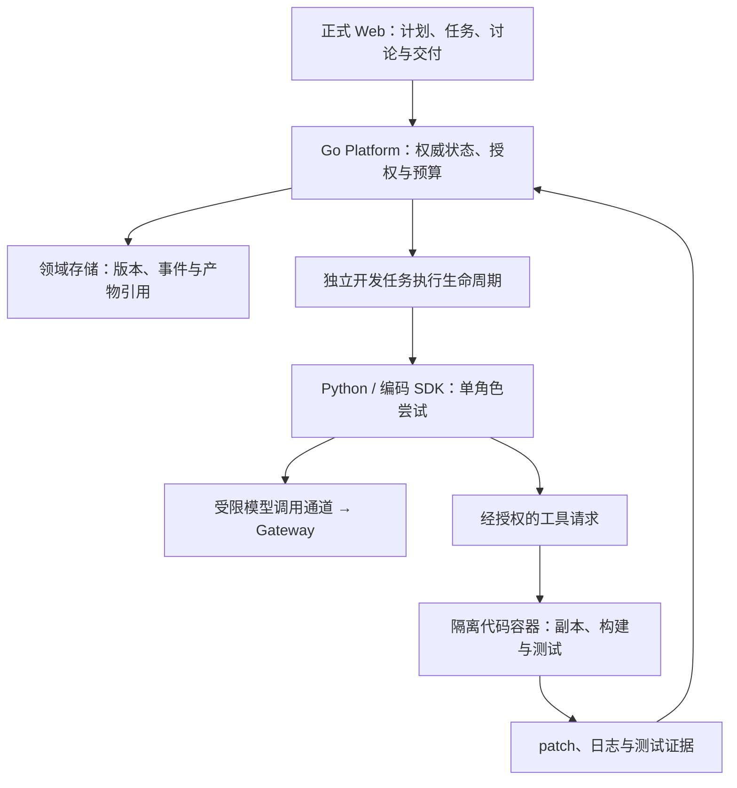

# 多 Agent 协同与受控软件开发团队 v1

更新时间：2026-11-05

状态：阶段 0 已实现代表任务、严格探针合同与离线准备 CLI，人工任务复验通过；SDK 1.59.0 独立镜像的 LLM 固定响应契约已通过；单尝试 SQLite / 提议 / 事件事务、当前资格、任务凭据和专属回环通道已实现并通过固定响应验证；受限 SDK 进程与代表任务完整事件、等待取消已用真实 Agent 固定响应验证；固定 Go 探针代码沙箱、受限文件 / 固定测试与归属清理已真实验收；开发产物合同与独立 SQLite 保存 / 导出已实现并定向验证；真实 SDK 同次候选修改 / 测试 / 保存 / 导出与命令中取消已固定响应联合验收；采用复评已完成但正式采用暂不通过；遥测可选化候选已移除默认专有代理链并独立复验，原生 HTTP 已通过固定上游技术验证，剩余依赖 / 镜像许可及阶段 1 范围 / 视觉依据待闭合，团队功能未启用。实施证据见[集中任务卡](../../task-cards/development-task-probe-v1-plan.md)。

## 决策来源与当前定位

项目所有者在[规划多 Agent 协同集成](codex://threads/01a178ab-d9ac-7c51-b56d-8ec4a47d2f1d)会话中明确选择“受控的软件开发团队”为首个场景，要求整理框架、角色、架构和分阶段方案，先不改代码；随后要求结合当前仓库进度纳入正式规划并建立专题和子专题。

原会话先讨论了通用协作框架，随后收敛为“Go 管理有限团队流程，优先验证 OpenHands Software Agent SDK 作为编码执行层”。本专题采用后续方案，不把早期候选比较解释为同时引入多个框架。角色方案、预算初值及框架推荐是设计输入，具体接口、依赖版本和执行授权仍需实施前确认。

当前工作台已有本地账户、工作区权限、Gateway、应用与 Workflow、SQLite、显式结果保存，以及宿主机和 `linux/arm64` 容器技术验收证据；独立用户和真实模型效果仍待验证。本功能按明确选择的**阶段 0 合同与接入验证**推进，不宣布工作台整体交付完成，也不自动恢复真实模型窗口。执行顺位由[当前焦点](../../radishmind-current-focus.md)与[路线图](../../radishmind-roadmap.md)统一维护。

## 用户目标与首轮范围

用户提交一个明确的软件开发任务，平台在隔离仓库副本中组织实现、测试和独立审查，交付可核验的候选变更，由用户决定是否接受及合入。

首轮面向项目所有者和内部开发者，限定一个工作区、一个明确授权的仓库、一个固定基准提交和一次有界运行。任务包括小型后端修复、前端交互、接口与页面联动、测试补漏。示例只使用授权测试副本，不自动把 RadishFlow、Radish 或其他本地工作区纳入可写范围。

完整用户流程：选择仓库与基准 → 填写需求和验收条件 → 审阅计划及接口约定 → 授权隔离执行 → 查看实现和测试 → 独立审查与有限返修 → 审阅并显式保存交付包。

交付包至少包含：

- 需求、验收条件、计划及团队定义的精确版本。
- 仓库基准提交、候选代码摘要、patch 与文件变更清单。
- 实际测试命令、退出码、环境标识、日志引用与受验代码摘要。
- 可定位的审查发现、修复记录、阻塞及未验证事项。
- 角色模型配置快照、实际调用尝试、用量来源、耗时与费用估算口径。

候选交付满足验收、用户接受、代码已合入是三个不同事实。首版不自动提交到用户分支、合并、推送或发布。

## 主专题与子专题分工

主要归属：[Workflow / Agent Runtime](../workflow-agent-runtime.md)；User Workspace、Gateway 与平台隔离为协同。五个职责文件共同支撑本功能，不因目录深度另造五条产品主线。[实施与评测子专题](controlled-software-development-team/implementation-and-evaluation-plan-v1.md)拥有阶段进入 / 退出标准，[集中任务卡](../../task-cards/development-task-probe-v1-plan.md)唯一维护阶段 0 任务结果；其余四个子专题维护对应合同，详细运行证据进入周志。

本专题统一拥有目标、首轮范围、角色、阶段顺序和完成判据。子专题按实际职责拆分，不按每个 Agent 建文档，不复制一套任务卡或准备门禁。

| 子专题 | 负责的问题 |
| --- | --- |
| [框架选型与 Gateway 接入](controlled-software-development-team/framework-and-gateway-integration-v1.md) | SDK 候选、兼容试验、模型与工具协议、依赖及采用条件 |
| [团队运行状态与证据](controlled-software-development-team/team-runtime-state-and-artifacts-v1.md) | 团队 / 任务 / 尝试、事件、预算、取消、持久化及结果归属 |
| [隔离代码执行与候选交付](controlled-software-development-team/isolated-code-execution-and-delivery-v1.md) | 仓库副本、文件与命令权限、凭据隔离、集成、测试及 patch |
| [协作工作区与群聊交互](controlled-software-development-team/collaboration-workspace-ui-v1.md) | 团队配置、计划确认、任务、时间线、变更与证据审阅 |
| [实施顺序与效果验证](controlled-software-development-team/implementation-and-evaluation-plan-v1.md) | 阶段 0 至 4、进入条件、技术与真实任务验证、剩余决策 |

## 角色、模型与协作

| 角色 | 职责与交付 | 权限边界 |
| --- | --- | --- |
| A 协调者 | 解释需求、任务分解、接口约定、依赖与返修建议 | 不扩大路径、工具、预算或网络授权；不独占最终审查 |
| B 后端开发 | Go 接口、领域实现、必要测试和契约影响说明 | 只写分配的后端路径 |
| C 前端开发 | React 交互、严格接口消费、构建与页面验证 | 只写分配的前端路径，遵守语义 token |
| D 测试 | 根据原始要求准备验收用例，在整合版本执行并记录缺陷 | 可写授权测试路径，不降低验收标准或删除失败用例制造通过 |
| R 独立审查者 | 重读需求、同一候选 diff 和测试证据，给出可定位发现 | 只读审查；结论是建议，不代替规则或用户合入决定 |

Agent、模型和执行环境分别配置。同一模型可承担多个角色，但使用独立上下文；不强制五个角色使用五种模型。角色定义应冻结模型引用、提示模板版本、上下文、工具策略和预算。更换模型或任务范围须形成显式修订，不静默替换。

A 先形成计划与接口约定，用户确认执行范围。公共 schema 和共享类型指定单一负责人后，B / C 才允许在独立副本并行；D 可提前准备测试。平台集成候选后，D 和 R 面向同一代码摘要工作。任何实现或测试变更使相关旧证据失效，必须重新验证。返修有次数、时间和费用上限。

平台审计记录由程序产生，不能由 A 或 R 的自然语言报告替代。群聊展示协作过程，任务和验收状态由规则及真实证据维护。

## 拟新增架构与当前能力的关系

图中团队调度、长任务和代码工具均为拟新增能力。Go 决定启动、取消、验收与继续资格，SDK 只负责一次角色尝试；不同时建立框架与平台两套恢复决策。长任务不占用现有短请求 Python 工作进程池，也不简单提高原 Agent 调用超时。

现有 `contracts/agent-copilot-profile-draft.schema.json` 固定 `allow_tool_calls=false`，`agent_copilot_invocation.go` 限制 30 秒；当前 northbound 构建也禁止工具调用。因此不能用配置打开编码能力或宣称 SDK 能直接接通 Gateway。需要独立评审版本化模型 / 工具合同、执行权限、长任务持久化和候选产物类型；旧 Agent / Copilot、Workflow、Session 与 Action Safety 合同保持原语义。

拟将团队定义和运行作为工作区内资源；模型调用必须关联明确的活跃应用，复用 Gateway 的既有归因基础。当前已复用活跃应用权威和管理员资格，逐任务确认后由可信 Go 签发，内部通道默认关闭；受限 SDK 固定响应已验，开发产物已按[独立合同](../../contracts/development-artifact-v1.md)实现，真实 SDK 联合技术验收已通过，采用复评发现的许可与原生传输缺口仍须收口，通用代码执行保持后置，不自动增加 `application_kind` 或复用不适用的旧凭据权限。

## 分阶段交付与排期

| 阶段 | 用户可观察结果 | 当前安排 |
| --- | --- | --- |
| 0 方案与选型验证 | 代表任务、SDK 采用证据、状态 / 安全 / 数据与 UI 设计可评审 | 代表任务与 SDK LLM 已验，单尝试事务 / 当前资格 / 内部通道已验；受限 SDK 与代码沙箱已分别验证，产物合同与内部保存链已验证；联合技术链已验，采用复评暂不通过；原生 HTTP 技术条件已验；许可未闭合，单 Agent 公开合同 / 六个代表面已设计待确认 |
| 1 单 Agent 隔离开发交付 | Web 可发起、取消、审阅并保存一个 Agent 的 patch 和测试证据 | 下一实施目标，先建立后续团队比较基线 |
| 2 固定开发团队 | A/B/C/D/R、有限并行、集成测试、独立审查和有限返修 | 阶段 1 可靠后推进，不先开放动态组队或递归委派 |
| 3 持续协作与中断处理 | 定向反馈、计划修订、运行历史、保留清理和显式后续尝试 | 基础持久化与取消从阶段 1 实现，本阶段补足持续使用体验 |
| 4 真实任务效果 | 同任务、同基准和预算下比较单 Agent 与团队 | 真实模型窗口恢复后执行，不以固定响应代替质量判断 |

独立用户验收与本功能设计可以分别推进；前者仍是工作台剩余交付依据。本功能不以跨版本回归审查、团队共享部署、真实 Radish OIDC 或生产密钥后端为默认前置，也不因纳入规划同时启动这些方向。整体效果验证仍沿用“技术链与真实质量分别报告”的路线。

## 首版执行约束与待验证参数

原会话提出的初值为：同时 1 个团队运行、最多 2 个写代码角色、8 个计划子任务、每个角色任务 20 个模型回合、2 轮整体返修、命令默认 120 秒、团队总时限 30 分钟。它们是待试验的配置建议，不是已经生效的额度；总 token / 费用和磁盘 / 输出预算必须在运行前另行明确。

授权至少绑定需求 / 计划版本、仓库基准、路径、工具、命令档案、网络、模型与预算。聊天、仓库文件和 SDK 自身确认提示不能增加权限。模型调用前原子预留预算；缺失用量显示未知或明确估算，不能记为零。

代码容器与工作台容器分开，默认无外网，不挂载宿主机 Docker socket、平台数据库、秘密目录或用户日常工作区。框架和可信工具控制层持有必要委托，仓库代码执行进程不继承平台 / 模型密钥。隔离设计与技术可行性必须单独验收。

## 完成判据与停止线

- 首个开发交付必须绑定同一需求、基准、候选代码和真实测试证据；保留失败和未验证项，不用角色消息声明通过。
- 超时、取消、越界、权限撤销、产物 / 存储失败和进程崩溃均有可审计行为；停止执行与停止新增调度分别记录。结果未知不伪装为成功或安全取消。
- 重启可读取持久化记录，不自动重放命令、补跑测试、恢复写入或合并候选；后续尝试重新验证权限、基准和预算。
- 固定响应可证明协议、状态、隔离和界面技术链；不能证明代码质量、多 Agent 收益或生产安全。
- 通用自治循环、无限制工具、跨仓库写入、任意依赖安装 / 联网、生产数据、自动合并 / 推送 / 发布继续关闭。首场景中的有界角色回合只能在其专属合同和授权下实现，不放宽通用 Agent 停止线。
- 当前只开放独立探针的离线 `check / prepare / inspect`。新增 schema 不改变正式平台权限、运行档、API 或迁移；SDK / 容器需按当轮明确范围授权，真实模型与真实用户试用继续暂停。
